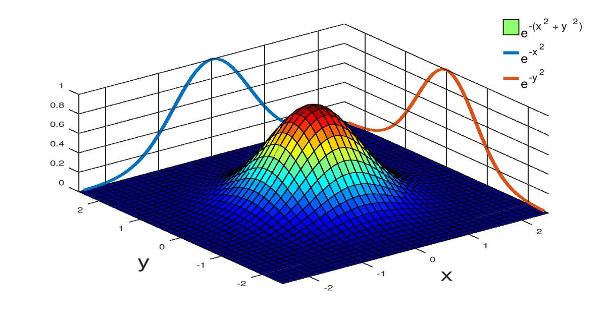

# Importing the the Sara_dataset.xls into R

```{r}
#| echo: FALSE

rm(list=ls())
```

```{r}
library(tidyverse)
library(readxl)
dataset <- read_excel("Sara_dataset.xls")

print(dataset, n = 5)
glimpse(dataset)
```

# Describe the variables using descriptive statistics

Sample size\
$n =$ `r nrow(dataset)`

Self-reported fear of mathematics (measured on a 0–10 scale)\
$\bar{x} =$ `r round(mean(dataset$phobia), 2)`   $s =$ `r round(sd(dataset$phobia), 2)`

Number of mathematics courses previously attended\
$\bar{x} =$ `r round(mean(dataset$prevmath), 2)`   $s =$ `r round(sd(dataset$prevmath), 2)`

Score on a mathematics pre-test (measured on a 0-50 scale)\
$\bar{x} =$ `r round(mean(dataset$mathquiz, na.rm = TRUE), 2)`   $s =$ `r round(sd(dataset$mathquiz, na.rm = TRUE), 2)`

Score on a statistics test(measured on a 0-10 scale)\
$\bar{x} =$ `r round(mean(dataset$statquiz, na.rm = TRUE), 2)`   $s =$ `r round(sd(dataset$statquiz, na.rm = TRUE), 2)`

# Analyse two of the variables

```{r}
#| code-fold: TRUE
#| warning: FALSE
dataset |> 
  ggplot(
    aes(
      x = phobia,
      y = mathquiz
    )
  ) +
  geom_jitter() +
  geom_smooth(method = "lm", col = "red", se = FALSE) +
  labs(
    title = "Fear of mathematics and math performance are negatively correlated 
(r = -0.28)",
    subtitle = "n = 100",
    x = "Self-reported fear of mathematics (0-10)",
    y = "Matemathics pre-test score (0-50)",
    caption = "data from Sara_dataset.xls"
  ) +
  theme(
    plot.title = element_text(face = "bold"),
  )

round(cor(dataset$mathquiz, dataset$phobia, use = "complete.obs"), 2)
```

# Inserting a two column section

::::: columns
::: {.column width="75%"}
**Variable**\
Self-reported fear of mathematics (0–10 scale)\
Number of mathematics courses previously attended\
Score on a mathematics pre-test(0-50 scale)\
Score on a statistics test(0-10 scale)\
Self-measured heart rate under normal conditions\
Self-measured heart rate before the test\
Self-measured heart rate after the test\
Scores on an anxiety test under normal conditions\
Scores on an anxiety test before the test\
Scores on an anxiety test after the test\
:::

::: {.column width="25%"}
$\bar{x}$\
`r mean(dataset[,4])`\
`r mean(dataset[,5])`\
`r round(mean(dataset[,6], na.rm = TRUE), 2)`\
`r mean(dataset[,7])`\
`r mean(dataset[,8])`\
`r mean(dataset[,9])`\
`r mean(dataset[,10])`\
`r mean(dataset[,11])`\
`r mean(dataset[,12])`\
`r mean(dataset[,13])`\
:::
:::::

# Including a word of a different color

I want to make this word [blue]{style="color: blue;"}, [red]{style="color: red;"} or [green]{style="color: green;"}.

# Inserting an image

**Three-dimensional normal distribution**

{fig-align="center"}


